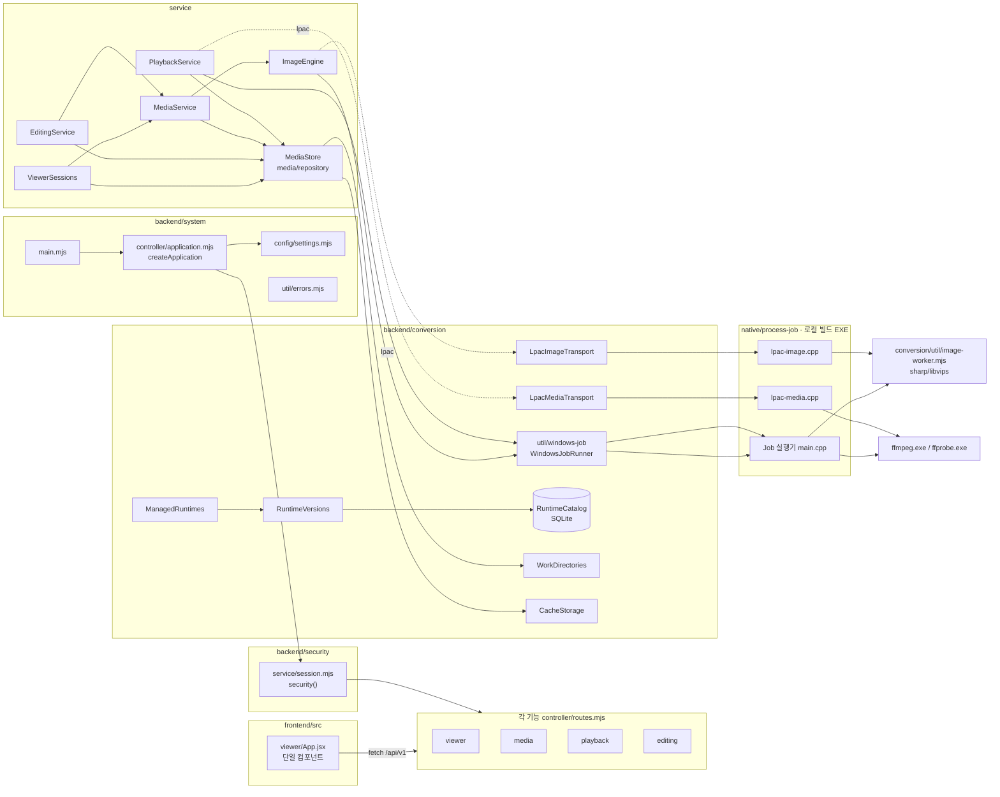

# 프로젝트 맵 (SimpleImgViewer / ImageGate)

2026-11-17 기준 소스(`2bd6a6a` + 미커밋 런타임 검증 worker 연결) 분석 결과입니다. 기능을 고치거나 추가할 때 **어떤 파일이 같이 움직이는지, 무엇을 다시 검증해야 하는지** 찾는 용도입니다. 남은 작업·보완 항목은 [REMAINING_WORK.md](REMAINING_WORK.md)에 따로 정리했습니다.

- 현재 실행 기준: Node.js 24.22.1 + Express 5 + React 19 + Vite 8 (Java/Gradle 제거됨)
- docs의 나머지 문서 다수는 Java 시절 또는 단계별 기록입니다. 현재 동작 판단은 **코드 → 이 문서 → NODE_REACT_MIGRATION.md → 각 주제 문서** 순으로 합니다. (문서 분류는 [10. 문서 맵](#10-문서-맵))
- 코드는 한 줄에 여러 문장을 넣은 압축 스타일입니다. 아래 파일:함수 이름으로 검색하면 빠릅니다.

---

## 1. 전체 구조 한눈에



| 계층 | 위치 | 역할 |
| --- | --- | --- |
| 진입 | `backend/main.mjs`, `scripts/dev.mjs`, `scripts/start.mjs` | 서버 시작, `--dev`만 자동 로그인 활성화 |
| 조립 | `backend/system/controller/application.mjs` | 설정→저장소→런타임→전송→서비스 생성, 미들웨어·라우트 등록, 종료 순서 |
| 설정 | `backend/system/config/settings.mjs` | 기본값 + YAML + override 병합, 범위 검증, 개발용 FFmpeg/Job 실행기 manifest 자동 연결 |
| 인증 | `backend/security/service/session.mjs` | 개발 모드 전용 쿠키 세션 + CSRF + Origin 검사. **운영 인증은 없음(항상 401)** |
| 기능 | `viewer` `media` `editing` `playback` `conversion` | 아래 2~5절 |
| 화면 | `frontend/src/viewer/App.jsx` (+ `viewer.css`) | 모든 UI·상태가 단일 컴포넌트에 있음 |
| 네이티브 | `native/process-job`, `native/imagegate-converter` | Windows Job/LPAC 실행기(C++), 로컬 빌드 후 해시로 고정 |

---

## 2. 기동·종료 흐름 (`createApplication`)

순서가 곧 의존성입니다. 앞 단계가 실패하면 뒤 단계는 만들어지지 않고, catch에서 역순 정리합니다.

1. `settings({development,overrides})`
   - `SIMPLEIMGVIEWER_CONFIG` 또는 `config/simpleimgviewer.yml` → 기본값과 섹션별 병합(`runtimeVersions.verification`은 필드 단위 병합)
   - 개발 모드: `build/native-modules/imagegate.native.yml`에서 playback 경로/해시, `build/process-job/launcher.json`에서 Job 실행기 경로/해시를 자동 주입(소스 해시가 `native/process-job/main.cpp`와 다르면 `PROCESS_JOB_BUILD_STALE`)
2. `storage.root`가 `dist` 안이면 거절 → `new MediaStore(config).init()`
   - `privateRoot`: `originals/ derived/ multipart/ stamps/ editing/ sessions/`
   - `TemporaryFiles.init()` – `multipart/transfers/owner.sqlite` 배타 잠금(=같은 저장소에 Node 서버 1개), 오래된 `.part` 회수
   - `UploadCapacity.init()` – originals 전체 스캔으로 원본 사용량 집계(이상 항목 있으면 기동 거절)
   - `WorkDirectories(image)`, `WorkDirectories(playback)` 회수 → `CacheStorage.init()` (기동 시에만 기간/용량 초과 캐시 삭제)
3. `runtimeVersions.enabled`면 `ManagedRuntimes.init()` → `RuntimeVersions.init()` → `RuntimeCatalog.open()` (+ `verification.mode: worker`면 `RuntimeVerifierPool`)
4. `createLpacTransports()` – `isolation.mode: lpac`일 때만 이미지/미디어 전송 생성, `--capabilities` 프로필 확인
5. `ImageEngine`, `PlaybackService.init()`(FFmpeg 해시·DLL baseline·LGPL/코덱 검사) → `MediaService`, `EditingService`, `ViewerSessions` → `sessions.cleanupExpired()`
6. 미들웨어 → 라우트 → 정적 `dist` → 404 → 오류 핸들러, `http.createServer`
7. 종료 `close()` (한 번만 실행되도록 공유 Promise): HTTP 닫기 + `images.close()` + `playback.close()` → `runtimes.close()` → `store.close()`

> 경로 대부분이 **현재 작업 디렉터리 기준 상대 경로**(`dist`, `config/…`, `build/…`, `.runtime/…`, `pnpm-lock.yaml`)입니다. 서버는 반드시 저장소 루트에서 실행해야 합니다.

---

## 3. HTTP 요청 파이프라인

```
요청 → 보안 헤더(nosniff, X-Frame-Options, CSP, Cache-Control:no-store …)
     → Host 헤더 형식 + server.allowedHosts 검사 (403 HOST_NOT_ALLOWED)
     → /actuator/health (인증 없음)
     → /api/*  : security(config)  ─ 운영: 401 / 개발: siv-session 쿠키, 비GET은 X-CSRF-TOKEN + Origin 검사
               express.json(64kb) ─ JSON 본문은 객체만 허용
     → 기능 라우트 (wrap → 비동기 오류를 next로)
     → /viewer/resources/TestFiles/* (개발 전용 URL 수신 샘플)
     → /viewer 정적(dist) → 404 JSON → 오류 핸들러(ApiError.code만 노출)
```

- 오류 규약: 서비스는 `requireThat(조건, status, CODE)`로 `ApiError`를 던지고, 응답은 `{code}`만 반환합니다. 화면은 `App.jsx`의 `messages[code]`로 한국어 안내를 매핑합니다. **새 오류 코드를 추가하면 `messages`도 함께 확인**하세요.
- 업로드 계열(`POST /media`, `/media/import-url`, `/stamps`)은 `application.mjs`의 `admission`으로 동시 2건 제한(429 `UPLOAD_BUSY`).

---

## 4. API 라우트 맵

| 메서드·경로 | controller | 서비스 호출 체인 | 기능 플래그 | 화면 호출 위치(App.jsx) |
| --- | --- | --- | --- | --- |
| GET `/api/v1/viewer/bootstrap` | viewer/routes | config만 읽음, CSRF 토큰 반환 | 응답에 features·limits 포함 | 초기 `useEffect` |
| POST `/api/v1/viewer/sessions` | viewer/routes | `ViewerSessions.create` → `store.require`×N → `scan` → `atomicJson` | – | `sessionFor` |
| GET `/api/v1/viewer/sessions/:id` | viewer/routes | `ViewerSessions.view` → `store.require` → `media.public` | – | `?sessionId=` 진입 |
| POST `/api/v1/media` | media/routes | `admission` → `receiveUpload` → `store.register` → `store.releaseTemp` | `features[mediaType]` | `openFiles` |
| POST `/api/v1/media/import-url` | media/routes | `admission` → `importRemote` → `store.register` | `remote.enabled` | `openUrl`, `?url=` 진입 |
| GET `/api/v1/media/:id` | media/routes | `store.require` → `media.public` | `features[mediaType]` | `?mediaId=` 진입 |
| GET `/api/v1/media/:id/pages/:page` | media/routes | `MediaService.page` (5.2) | image | `select` |
| GET `/api/v1/media/:id/status`, POST `…/previews` | media/routes | `MediaService.page`와 동일(`?page=`) | image | 사용 안 함 |
| GET `/api/v1/media/:id/sources/:sourceId/{content,thumbnail}` | media/routes | `MediaService.source` → PNG `sendFile` | image | ``·썸네일·돋보기 |
| GET/POST `/api/v1/media/:id/playback` | playback/routes | `PlaybackService.prepare` (5.6) | `playback.enabled`, video/audio | `select`(POST) |
| GET/HEAD `/api/v1/media/:id/playback/sources/:sourceId/content` | playback/routes | `PlaybackService.source` → 단일 Range 스트리밍 | `playback.enabled` | `<video>/<audio src>` |
| GET `/api/v1/stamps` | editing/routes | `stampsEnabled` → `EditingService.listStamps` | stamps | 부트스트랩·업로드 후 |
| POST `/api/v1/stamps` | editing/routes | `admission` → `receiveUpload(2MiB, 원본 아님)` → `createStamp` | stamps+stampUpload | `uploadStamp` |
| GET `/api/v1/stamps/:id/content` | editing/routes | `stampsEnabled` → `EditingService.stamp` → PNG | stamps | 스탬프 `` |
| GET `/api/v1/media/:id/pages/:page/annotations` | editing/routes | `EditingService.document` → `media.page` | – | `select` |
| POST `…/annotations` · PUT/DELETE `…/annotations/:itemId` · POST `…/annotations/history/{undo,redo}` | editing/routes | `EditingService.change` (5.4) | annotations / stamps | `saveItem`, `historyChange` |
| POST `…/pages/:page/crop` · `…/export` | editing/routes | `EditingService.export` (5.5) | cropAndSave / exportEdited (+brightness·rotation·annotations·stamps) | `download(false/true)` |
| GET `/viewer/resources/TestFiles/*` | application | 개발 모드 + `.runtime/development/url-files/TestFiles` | development | URL 수신 시험용 |
| GET `/actuator/health` | application | `{status:'UP'}` | – | – |

---

## 5. 기능별 호출 체인

### 5.1 파일 업로드·URL 수신

```
App.openFiles ─ 파일마다 순차 POST /api/v1/media (FormData) ─ 이후 sessionFor(all) → select(added[0])
  media/routes → admission(동시 2)
    receiveUpload(req, store)                       media/service/upload.mjs
      store.temp()  → TemporaryFiles.allocate() + UploadCapacity.reserve(max 크기 선예약, 디스크 여유/원본 한도)
      busboy(files:1, fields:0) → .part 파일 기록 (fileSize 초과 413)
    store.register(temp, fileName, actor)          media/repository/store.mjs
      regular() → capacity.check → 앞 512B로 detect() → features 검사 → digest(SHA-256)
      originals/<uuid>/source 로 rename → capacity.commit → record.json(atomicJson)
    finally store.releaseTemp() → 예약 반환
  → media.public(record)  (permissions는 현재 하드코딩 true)

importRemote(body, store, actor)                    media/service/remote.mjs
  remoteUrl(): IP 리터럴 host만, 사용자정보/해시/모호한 경로/인코딩 차단, allowedPrefixes 접두 일치
  fetch(redirect:manual, identity) → 크기 제한 Transform → temp → store.register
```

- 형식 판별: `media/util/files.mjs:detect` (PNG/JPEG/GIF/BMP/TIFF/WebP, WAV/MP3, MP4(ftyp, HEIF 브랜드는 unsupported), MPEG-PS). **새 입력 형식은 detect + image-worker 허용 format + playback 포맷 매핑 + 화면 표시를 함께 수정**해야 합니다.

### 5.2 이미지 페이지 정보·미리보기 (핵심 뷰잉 경로)

```
App.select(record, page) → GET /media/:id/pages/:page → 이어서 GET …/annotations
MediaService.page → ImageEngine.withRuntime(runtime => pageWithRuntime)
  runtime = ManagedRuntimes.acquire('node') (관리형일 때만) – 전체 트리 SHA 검증 포함
  pageWithRuntime:
    store.require(id, actor)  – record.json, tenant/owner(개발 모드는 owner 우회), features
    store.verify(record)      – 원본 전체 SHA-256 재계산 ①
    target = derived/<mediaId>-<sourceId>
      sourceId = sha256(sha256 + mediaVersion + ':sharp-node-v2:' + identity + ':' + page + ':' + previewEdge)
      identity = 관리형 runtime.identity | sha256(image-worker.mjs + work-lease.mjs + bmp.mjs + pnpm-lock.yaml)
    running Map으로 같은 (version,page,identity) 동시 요청 합치기
    prepare():
      캐시 적중: facts.json 바인딩 검사 + preview.png 확인 + cache.touch → 반환
      캐시 미스: store.work.create() (derived/image-work/<uuid> + lease.sqlite)
        → ImageEngine.run({operation:'preview', input, page, edge, output, thumbnail})
            동시 처리 processing.concurrency 초과 시 429 PREVIEW_QUEUE_FULL
            [windows-job] job.json 기록 → WindowsJobRunner.command() → spawn(Job 실행기 -- node image-worker.mjs job.json)
            [lpac]        LpacImageTransport.run() → lpac-bindings → SIVLPAC1 요청 → native lpac-image
            image-worker: retired 표식 확인 → sharp(rotate→resize(edge)→png) + 256px 썸네일 → stdout JSON facts
        → facts.json 기록 → work.publish(target, cache, beforePublish: require+verify+runtime.verify)
          → CacheStorage.publish(용량 초과 507) → rename → work.release
    다시 store.require + store.verify ② → 응답(좌표계, previewToOriginal 행렬, source/thumbnail URL)

GET /sources/:sourceId/content|thumbnail → MediaService.source
  store.require → store.verify ③ → facts 재바인딩(sourceId 재계산) → cache.touch → sendFile
```

- 한 이미지를 처음 열 때 원본 SHA-256 전체 계산이 `page`(2회) + `annotations`(내부 `page` 2회) + `content`(1회) + `thumbnail`(1회) = **최소 6회** 일어납니다. 큰 원본의 뷰잉 지연 원인 후보입니다(REMAINING_WORK 참고).
- 캐시 키(sourceId) 공식, `CacheStorage`의 디렉터리 이름 정규식, `MediaService.source`의 재계산은 **한 세트**입니다. 하나를 바꾸면 셋 다 바꿔야 하며 기존 캐시는 무효(고아)가 됩니다.

### 5.3 좌표계 (화면 ↔ 서버)

- 서버 응답: `coordinateWidth/Height`(EXIF 회전 반영한 원본 픽셀), `displayWidth/Height`(미리보기), `coordinateSpaceId = original:<mediaVersion>:<page>:upright-v1`.
- 화면 `App.point()`가 화면 좌표 → 회전(angle)·확대(zoom)·이동(pan) 역변환 → 원본 좌표로 바꿉니다. 메모/스탬프/자르기 영역은 모두 **원본 좌표**로 저장·전송됩니다.
- 회전·밝기는 화면에서는 CSS(`transform`, `filter`)만, 서버 반출 시에만 `image-worker`가 실제 적용합니다.

### 5.4 메모·스탬프 편집

```
App.pointerDown(tool=note|stamp) → saveItem → POST …/annotations
App 드래그 종료/크기·내용 수정 → PUT …/annotations/:itemId ;  삭제 → DELETE ;  undo/redo → POST …/history/:dir
EditingService.change(id, page, actor, body, action, itemId)
  (id:page) 단위 Promise 잠금
  document() → media.page()(5.2 전체 경로) + editing/<mediaId>-<page>.json (없으면 빈 문서)
  body.mediaVersion/coordinateSpaceId/expectedRevision 불일치 → 409 EDIT_CONFLICT
  item 검증: note|stamp, 원본 영역 안, w*h ≤ 4,194,304, note ≤ 500자, 페이지당 200개, 스탬프 소유 확인
  undo 스택 20개, redo 초기화 → revision++ → atomicJson
```

- 스탬프 업로드: `createStamp` → PNG/JPEG/WebP만 → `ImageEngine.run(preview, edge 1024, maxPixels 4MP)`로 재인코딩 → `stamps/<uuid>.png` + `.json`, 사용자당 100개.
- 한도 숫자(200, 500, 100, 2MiB, 8MP)는 **서버 서비스 코드와 `viewer/routes.mjs`의 bootstrap `limits`에 중복** 정의되어 있습니다.

### 5.5 자르기·편집본 저장

```
App.download(edited) → POST …/crop | …/export  {mediaVersion, coordinateSpaceId, expectedRevision, x,y,width,height, brightness, rotation, includeAnnotations}
EditingService.export → ImageEngine.withRuntime → exportWithRuntime
  features(cropAndSave | exportEdited) → document() → 좌표/크기(≤8MP) 검증 → edited면 revision 검사
  밝기≠100이면 features.brightness, 회전≠0이면 features.rotation 필요(아니면 403; crop은 항상 100/0)
  items: 꺼진 기능(annotations/stamps) 항목 제외 → 스탬프는 파일 경로 결합, 합계 ≤16MP → ImageEngine.run({operation:'export', crop, brightness, rotation, items})
    image-worker: rotate(EXIF) → modulate(brightness) → composite(메모 SVG/스탬프) → extract(crop) → rotate(rotation)
    메모 SVG: 고정 템플릿 + escape, LPAC에서는 승인 폰트(Noto Sans CJK KR) 필수
  → 원본/버전/runtime 재검증 → PNG 바이트 응답(attachment)
```

### 5.6 동영상·음성 재생

```
App.select(video|audio) → POST /media/:id/playback → <video|audio src=info.url>
PlaybackService.prepare → withRuntime(ManagedRuntimes.acquire('ffmpeg') 선택) → prepareWithRuntime
  (mediaVersion:identity) 동시 요청 합치기, 동시 2건(429 PLAYBACK_QUEUE_FULL)
  convert():
    store.verify + FFmpeg 변경 검사(verify) + approveManaged
    sourceId = sha256(sha256 + mediaVersion + identity + ':node-playback-v2') → derived/playback-<sourceId>
    캐시 적중이면 facts 반환
    probe-input(ffprobe, 포맷 화이트리스트) → 길이 ≤2h, 스트림 ≤32, 해상도 ≤ 8,294,400px, fps ≤60, 채널 ≤8
    playbackWork.create → runProfile(video: VP8+Opus WebM ≤1080p / audio: MP3 192k)
    결과 probe-output 재분석 → facts.json → playbackWork.publish(cache)
  runProfile(): ffmpegProfile()로 고정 인자 생성 → [windows-job] run() spawn Job 실행기 / [lpac] LpacMediaTransport
GET …/playback/sources/:sourceId/content → PlaybackService.source → 크기·바인딩 검사 → 206 Range 스트리밍
```

- `playback/util/ffmpeg-profile.mjs`는 **PlaybackService, conversion/util/lpac-bindings(mediaLpacBinding), native lpac-media 요청 인코딩**이 공유합니다.
- 화면 `App.jsx`의 `mediaProps`가 `<video>`·`<audio>` 공통 처리를 담당합니다. 세션 시작 시간 적용(`onLoadedMetadata`), 탐색 제한(`lastTime` 기준 0.5초 초과 이동 되돌림), 배속 제한(`controlsList`, `onRateChange`)을 여기서 처리합니다. 서버 Range 전달은 이 설정과 무관합니다.

### 5.7 뷰어 세션·진입 URL

- `/viewer?sessionId=` → 세션 복원(목록·테마·좌측 패널·선택 파일·시작 페이지/시간), `/viewer?mediaId=` → 단일 파일, `/viewer?url=` 또는 `#url=` → URL 수신 후 주소창 정리.
- 세션 파일 `sessions/<uuid>.json`, TTL 기본 30분, 기동·생성 시 만료분 삭제, 최대 1000개.

---

## 6. 저장소 레이아웃

```
storage.root (기본 .runtime/node/media)
├─ originals/<mediaId>/source, record.json        원본(자동 삭제 없음) + 메타(tenant/owner/sha256/mediaVersion)
├─ derived/
│  ├─ <mediaId>-<sourceId>/facts.json, preview.png, thumbnail.png   이미지 캐시
│  ├─ playback-<sourceId>/facts.json, playback                     재생 캐시
│  ├─ image-work/<uuid>/lease.sqlite, retired, job.json …          이미지 작업(회수 대상)
│  └─ playback-work/<uuid>/…                                      FFmpeg 작업
├─ multipart/transfers/owner.sqlite, <uuid>.part   업로드 임시 + 저장소 소유 잠금
├─ stamps/<stampId>.png, .json
├─ editing/<mediaId>-<page>.json                   메모/스탬프 문서 + undo/redo
└─ sessions/<sessionId>.json
runtimeVersions.root (기본 .runtime/node/runtimes)  owner.sqlite, catalog.sqlite, versions/<uuid>/{payload,runtime.use}
isolation.root      (기본 .runtime/node/lpac)      LPAC 작업 풀 image/, media/
```

---

## 7. 설정 → 코드 영향 맵

| YAML 섹션 | 읽는 곳 | 바꿀 때 함께 볼 것 |
| --- | --- | --- |
| `server` (host/port/allowedHosts) | application(Host 검사), main | `scripts/test-proxy-config*`, `config/proxy/*` |
| `storage` | MediaStore, UploadCapacity, settings(dist·runtime·lpac 루트 겹침 검사) | 6절 레이아웃 |
| `upload` | receiveUpload, store.register/verify, UploadCapacity, bootstrap limits | 화면 오류 메시지 |
| `processing` | ImageEngine(동시성/timeout/maxPixels), WindowsJobRunner(Job 한도), MediaService(previewEdge → sourceId) | previewEdge 변경 시 캐시 전체 무효 |
| `features` | store(mediaType), editing(주석·스탬프·반출의 밝기/회전), editing/routes(스탬프 조회), viewer bootstrap, lpac-factory, App.jsx(버튼 활성화, 주석 표시 필터, `mediaProps`의 탐색·배속 제한) | zoom·magnifier·seek·playbackSpeed는 화면 전용 제한(서버 강제 아님) |
| `remote` | importRemote, bootstrap `remoteImport` | `scripts/create-url-sample*` |
| `playback` | PlaybackService, WindowsJobRunner(playback) | `scripts/install-native-modules.ps1` |
| `sessions` / `temporary` / `cache` | ViewerSessions / TemporaryFiles·WorkDirectories / CacheStorage | 각 회수·정리 테스트 |
| `runtimeVersions` (+`verification`) | ManagedRuntimes, RuntimeVersions, RuntimeVerifierPool | RUNTIME_VERIFIER_CONFIGURATION.md |
| `isolation` | lpac-factory, LpacTransport, LpacWorkRecovery | LPAC_INSTALLATION_LOAD.md |

예제 스키마는 `config/simpleimgviewer.example.yml`, 기본값·검증은 `settings.mjs` 한 곳입니다. **키를 추가하면 둘 다 수정**합니다(알 수 없는 키는 400 `INVALID_CONFIGURATION`으로 기동 거절).

---

## 8. 변경 영향도 — "이걸 바꾸면 같이 확인할 것"

| 바꾸는 대상 | 함께 영향받는 곳 | 최소 재검증 |
| --- | --- | --- |
| `system/util/errors.mjs` (`requireThat`, `uuidPattern`, `integer`) | 백엔드 전체 | 전체 Node 테스트 |
| `media/util/files.mjs` `regular/digest/atomicJson/readJson/privateRoot` | store, media, editing, playback, sessions, cache, work, image-worker, note-font, windows-job | 전체 Node 테스트(+네이티브) |
| `media/util/files.mjs` `detect` | 업로드·URL·스탬프 판별, TestFiles 응답 | server.test, 화면 업로드 시나리오 |
| `conversion/util/image-worker.mjs` | ImageEngine identity(→ 모든 이미지 캐시 무효), LPAC 이미지 실행, **관리형 런타임 스냅샷 내부 경로 `backend/conversion/util/image-worker.mjs`** | image-job, lpac-bindings, managed-runtimes 테스트, `SIV_NATIVE_TESTS=1`, 관리형 사용 시 런타임 재게시 |
| `conversion/util/work-lease.mjs`, `bmp.mjs` | 위와 동일(identity 포함), WorkDirectories, LPAC 전송 | work-directories, image-job |
| `playback/util/ffmpeg-profile.mjs` | PlaybackService, lpac-bindings `mediaLpacBinding`, native lpac-media | windows-job, lpac-media-transport, lpac-bindings, `scripts/test-lpac-media-transport.mjs` |
| `*-lpac-*-request.mjs` (SIVLPAC1 바이너리 형식) | `native/process-job/lpac-request.h`, lpac-image.cpp, lpac-media.cpp | 네이티브 재빌드 + LPAC 전송 테스트 |
| sourceId 공식 / 캐시 디렉터리 이름 | MediaService(page/source), PlaybackService(convert/source), CacheStorage 정규식 | cache-storage, server.test |
| 오류 코드 추가·변경 | App.jsx `messages` | 화면 오류 표시 |
| 한도 값(주석 200, 메모 500, 스탬프 100/2MiB, 자르기 8MP) | editing.mjs, editing/routes, viewer/routes bootstrap, lpac-bindings, App.jsx(maxLength) | server.test |
| `settings.mjs` 키 | example.yml, 해당 서비스, `backend/test/system/config/*` | settings 테스트 + 기동 확인 |
| `native/process-job/main.cpp` | 개발 모드 manifest 해시(`PROCESS_JOB_BUILD_STALE`) | `scripts/build-process-job.ps1 -TestTools` 후 전체 테스트 |
| API 응답 필드 | App.jsx 해당 함수, `scripts/test-node-viewer.mjs`(브라우저 시나리오) | 빌드 + 브라우저 시나리오 |
| `frontend/src/viewer/App.jsx` | 단일 파일이라 모든 UI 기능 | `node scripts/build-web.mjs` + 브라우저 시나리오 |

---

## 9. 테스트·스크립트 맵

### 9.1 Node 테스트 (`backend/test`, `pnpm test` = `node --test "backend/test/**/*.test.mjs"`)

| 파일 | 주 대상 | 비고 |
| --- | --- | --- |
| server.test.mjs (20) | application 전체 HTTP: 업로드·URL·페이지·주석·반출·세션·보안 헤더·CSRF·기능 설정 | 통합 회귀의 중심 |
| cache-storage.test.mjs (6) | CacheStorage | 루트에 있음(기능 폴더 미정리) |
| image-job.test.mjs (4) | ImageEngine + Job 실행기 | 네이티브 필요 |
| playback-native.test.mjs | 실제 FFmpeg 재생 | `SIV_NATIVE_TESTS=1` |
| sessions / temporary-files / upload-capacity / work-directories / windows-job | 각 서비스 | 루트에 있음 |
| conversion/service/* | lpac-image-transport, lpac-work-recovery, managed-runtimes, managed-verifier(미커밋), note-font, runtime-verifier-pool, runtime-versions | |
| conversion/util/* | lpac-bindings, runtime-inventory | |
| playback/service/lpac-media-transport | LpacMediaTransport | |
| system/config/* | lpac-settings, runtime-verifier-settings(미커밋) | |

- 2026-11-17 실행 결과: `SIV_NATIVE_TESTS=1`에서 **142/142 통과**(약 26초). 환경 변수가 없으면 네이티브 16개를 건너뜁니다.
- 화면(React) 단위 테스트는 없습니다. 화면 검증은 `scripts/test-node-viewer.mjs`(Playwright + Chrome, `IMAGEGATE_NODE_MODULES`/`IMAGEGATE_BROWSER` 환경 변수 필요, Playwright는 의존성에 없음)뿐입니다.

### 9.2 scripts 분류

| 분류 | 파일 |
| --- | --- |
| 실행·빌드 | dev.mjs, start.mjs/.ps1/.sh, build-web.mjs, audit-node-licenses.mjs |
| 설치 | install-node-runtime.ps1, install-native-modules.ps1, install-note-font.mjs, create-url-sample.* |
| 네이티브 빌드 | build-process-job.ps1, build-lpac-image/media.ps1, build-*-lpac*.ps1, build-libvips-*.ps1, build-storage-watch.ps1, prepare-libvips-headers.ps1 |
| 스테이징 | stage-sharp-lpac.mjs, stage-ffmpeg-lpac.mjs |
| 수동 검증·측정 | test-node-viewer.mjs(브라우저), test-lpac-*, test-*-lpac.mjs, test-runtime-*, test-managed-runtime-services.mjs, test-proxy-config*, test-storage-watch.mjs, test-native-*.ps1 |

---

## 10. 문서 맵

| 구분 | 문서 |
| --- | --- |
| **현재 기준(먼저 읽기)** | 이 문서, [REMAINING_WORK.md](REMAINING_WORK.md), [ARCHITECTURE.md](ARCHITECTURE.md), [NODE_REACT_MIGRATION.md](NODE_REACT_MIGRATION.md), README.md, AGENTS.md |
| 현재 Node 구현 상세 | LPAC_*.md, MANAGED_RUNTIME_EXECUTION.md, RUNTIME_VERSION_LIFECYCLE.md, RUNTIME_VERIFIER_*.md, RUNTIME_VERIFICATION_*.md, RUNTIME_RESPONSIVENESS.md, NODE_LPAC_INTEGRATION.md, FFMPEG_LPAC_INTEGRATION.md, LEGACY_SOURCE_REMOVAL.md, INSTALLATION.md |
| Java 시절 기록(현재 실행 규칙 아님) | DEVELOPMENT_PLAN.md, API_CONTRACT.md, TILE_*.md, IMG2TILE_*.md, LIBVIPS_*.md, PREVIEW_*.md, ORIGINAL_*.md, PUBLICATION_*.md, LINKED_*.md, BACKUP_*.md, AUDIT_LOGGING.md 등 — 요구사항·설계 의도 참고용 |

---

## 11. 작업할 때 쓰는 절차

1. 이 문서 4~5절에서 대상 기능의 호출 체인을 찾고, 8절에서 영향 범위를 확인합니다.
2. 수정 후 최소 검증:
   ```powershell
   $node = '.tools/runtimes/node-24.22.1/node.exe'
   $env:SIV_NATIVE_TESTS = '1'; & $node --test "backend/test/**/*.test.mjs"
   & $node scripts/build-web.mjs
   ```
3. 화면·API 변경이면 브라우저 시나리오(`scripts/test-node-viewer.mjs`) 또는 `node scripts/dev.mjs` 실행 후 실제 브라우저로 확인합니다.
4. 호출 체인이나 파일 구성이 바뀌면 이 문서의 해당 절을, 작업이 끝나거나 새로 생기면 REMAINING_WORK.md를 갱신합니다.
